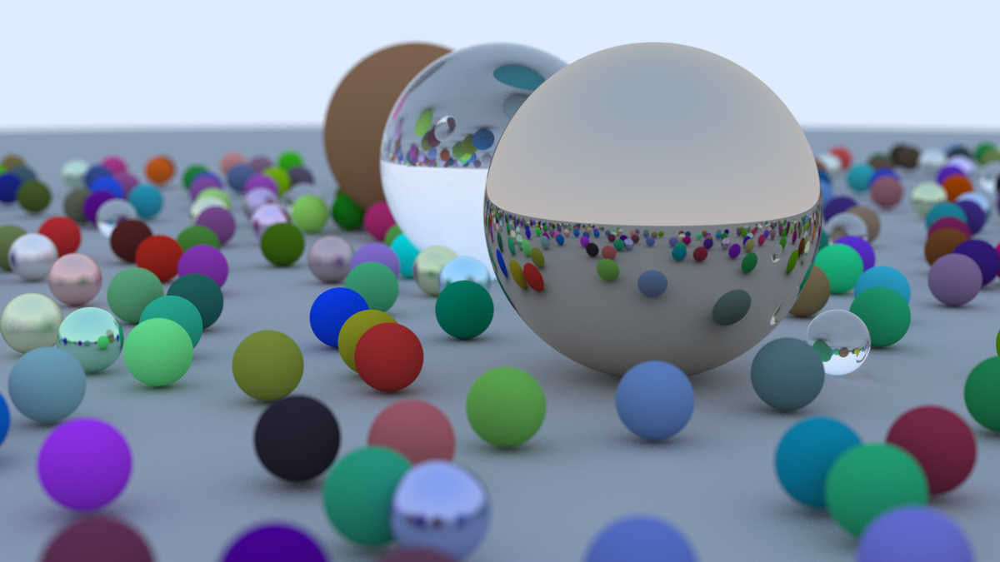

# ray-tracer

CPU path tracer in C++17. I built it following [Ray Tracing in One Weekend](https://raytracing.github.io/books/RayTracingInOneWeekend.html), then made it multithreaded and added a BVH.



1200x675, 500 samples per pixel, 485 spheres.

## Features

- diffuse, metal and glass materials
- antialiasing and defocus blur
- multithreaded with `std::thread`, each thread has its own RNG
- bounding volume hierarchy
- the image comes out the same for any number of threads, so the threading can be tested by comparing images

## Building

Needs CMake and a C++17 compiler.

```sh
cmake -S . -B build
cmake --build build --config Release -j
./build/raytracer --width 1200 --spp 500 --out final.png
./build/tests
```

With Visual Studio the binaries end up in `build/Release/` instead. `--config Release` matters there, otherwise you get a much slower debug build.

`./build/raytracer --help` lists the other options (thread count, how rows get split between threads, turning the BVH off).

## Performance

From `scripts/bench.sh`, 400px wide, 32 samples per pixel, 2 cores

| Configuration | Time (s) | Speedup | Thread busy min / max (s) |
|---|---|---|---|
| 1 thread, no BVH | 18.95 | 1.0x | |
| 1 thread, BVH | 2.99 | 6.3x | 2.99 / 2.99 |
| 2 threads, BVH, equal bands | 1.95 | 9.7x | 1.18 / 1.95 |
| 2 threads, BVH, atomic row counter | 1.52 | 12.5x | 1.51 / 1.52 |

My first version split the image into equal bands of rows, one per thread. Timing each thread showed the top band finishing way early, because it's mostly sky and a sky ray only needs one hit test. Handing out rows one at a time from an atomic counter keeps every thread busy until the end.

## Notes

- The book uses one static RNG, which becomes a data race once there are multiple threads. Here each thread has its own, and each row is seeded from its row number, so it doesn't matter which thread renders which row.
- The tests check the BVH gives exactly the same hits as brute force on 200k random rays, and that the image is byte-identical across thread counts, both schedules, and with the BVH on or off. They also pass under ThreadSanitizer.
- The ground is a sphere with radius 1000, so its bounding box is huge and hurts the BVH. A plane would be better.

## Credits

Ray Tracing in One Weekend by Peter Shirley, Trevor David Black and Steve Hollasch. PNG output uses [stb_image_write](https://github.com/nothings/stb).
